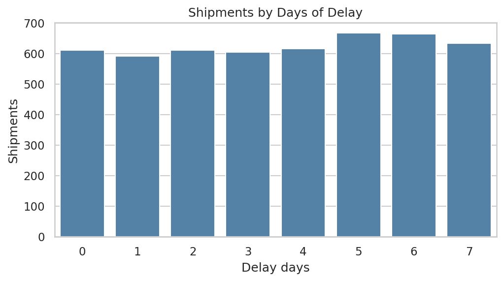
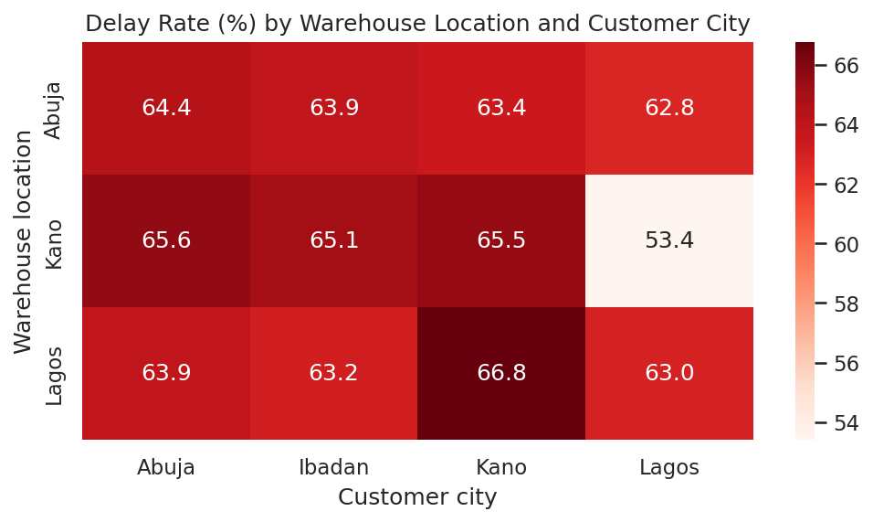
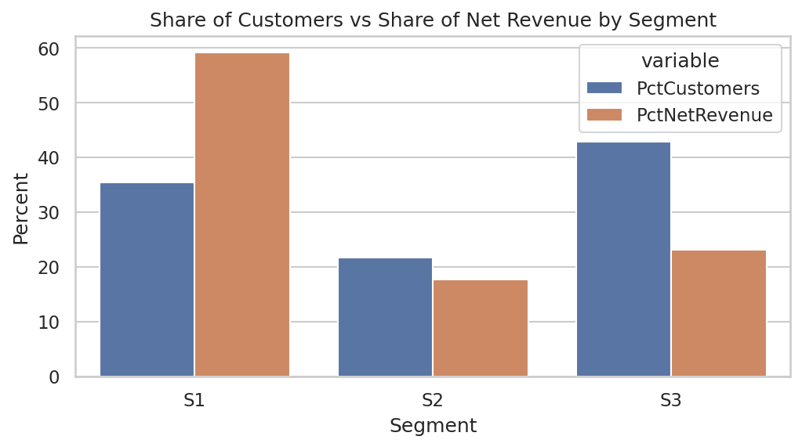
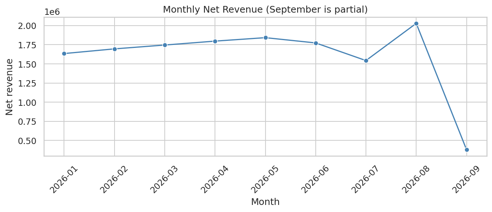
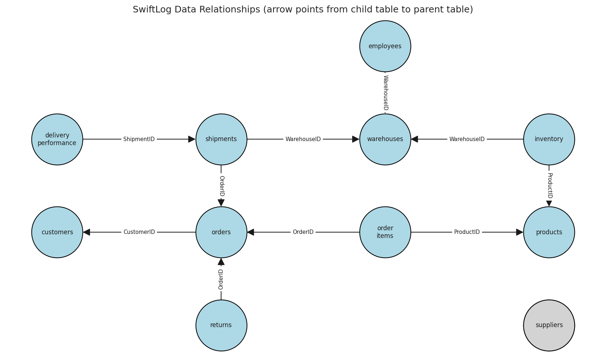

<div align="center">

# 🚚 SwiftLog Logistics: Supply Chain Intelligence & Feature Engineering

**Exploratory analysis, statistical testing, feature engineering and segmentation for a Nigerian logistics company**


*AnalystLab Africa Experience Lab · Week 5 · Data Science Track · Mission DS05*

</div>

---

## Table of contents

- [Overview](#overview)
- [Headline results](#headline-results)
- [Selected visuals](#selected-visuals)
- [Recommendations](#recommendations)
- [Repository structure](#repository-structure)
- [Getting started](#getting-started)
- [Methodology](#methodology)
- [Key definitions](#key-definitions)
- [Limitations](#limitations)
- [Deliverables](#deliverables)
- [Author](#author)

## Overview

SwiftLog Logistics Limited is expanding quickly and is seeing delivery delays, inventory imbalances and operational bottlenecks. Before investing in machine learning, management wanted to understand what its operational data actually says.

This project integrates **11 linked tables** (5,000 orders, 1,000 customers, 15 warehouses, 250 products, 15,000 order lines, 5,000 shipments, 500 returns; **1 Jan to 8 Sep 2026**), then:

1. validates and cleans the data,
2. explores it with 28 charts,
3. tests six business hypotheses,
4. engineers features for future predictive models,
5. segments customers and warehouses,
6. delivers 13 evidence-backed recommendations.

## Headline results

| Finding | Evidence |
|---|---|
| Data is structurally clean but incomplete | 0 missing values, 0 orphan keys. Suppliers link to no table; no capacity or delivery dates |
| Revenue leaks through cancellations | Net revenue 14.44M vs 21.67M gross; **7.23M (a third) cancelled** |
| Only 1 in 3 orders is delivered | 33% delivered, 34% pending, 32.5% cancelled |
| Delivery delay is systemic | **63.7%** of shipments are 3+ days late; no significant warehouse (p = 0.328) or city (p = 0.099) differences |
| One route stands out | **Kano → Lagos: 53.4% delayed** (249 orders, Bonferroni-adjusted p = 0.008) |
| One segment carries the business | S1 customers: **35% of customers, 59% of net revenue** |
| Returns are a steady ~9.5% of orders | Unrelated to delay (p = 0.928); 36% of "Late Delivery" returns came from on-time shipments |
| Inventory does not reconcile | Stock ≈ 28× units sold; 34.4% of shipped warehouse-product pairs have no inventory record |

> **Honest note:** five of six hypothesis tests found no significant difference, and several distributions are uniform, which suggests the data may be simulated. Null results are reported as findings, not explained away.

## Selected visuals

<table>
<tr>
<td align="center"><br><sub>Delay is spread evenly across 0 to 7 days</sub></td>
<td align="center"><br><sub>Kano → Lagos is the only route that differs</sub></td>
</tr>
<tr>
<td align="center"><br><sub>S1 customers drive most revenue</sub></td>
<td align="center"><br><sub>Monthly net revenue (September is partial)</sub></td>
</tr>
</table>

<details>
<summary><b>Data relationship diagram</b></summary>
<br>

</details>

## Recommendations

| # | Area | Recommendation |
|---|---|---|
| 1 | Delivery | Study and replicate the Kano → Lagos route process |
| 2 | Logistics | Run a company-wide delay-reduction programme with a clear target |
| 3 | Monitoring | Record promised and actual delivery dates; revisit the 3-day "on time" tolerance |
| 4 | Cost | Investigate cancellations and capture a cancellation reason |
| 5 | Operations | Set an ageing rule for pending orders |
| 6 | Inventory | Reconcile stock records with shipments; set reorder levels |
| 7 | Inventory | Right-size and rebalance stock between warehouses |
| 8 | Warehouses | Pilot a monitored staffing rebalance |
| 9 | Retention | Protect S1 customers; win back S3 with bundles and offers |
| 10 | Returns | Add picking verification and packaging checks; follow up with S2 |
| 11 | Monitoring | Build a weekly KPI report |
| 12 | Growth | Expand Food; plan capacity for April and August peaks |
| 13 | Data quality | Link suppliers, capture capacity, validate return reasons |

Full evidence for each is in `Reports/Technical_Report.pdf`.

## Repository structure

```text
Week5_DataScience_SwiftLog/
├── Data/
│   ├── Original_Datasets/              # 11 SwiftLog CSVs + data dictionary
│   ├── Cleaned_Datasets/               # *_clean.csv, order_master, item_master,
│   │                                   # order_master_encoded, cleaning_log, feature/segment files
│   └── Feature_Engineered_Dataset.csv  # one row per order, 43 columns
├── Notebook/
│   └── Week5_DataScience.ipynb
├── Reports/
│   ├── Data_Profiling_Report.html
│   ├── Technical_Report.pdf
│   └── Executive_Summary.pdf
├── Visualizations/
│   ├── Charts/                         # 29 PNGs (00 diagram, 01 to 28 analysis charts)
│   └── Dashboards/
├── Presentation/
│   └── Executive_Presentation.pptx
└── README.md
```

## Getting started

**Run in Google Colab**

1. Open `Notebook/Week5_DataScience.ipynb` in Colab and mount Google Drive.
2. Set `root` in the first cell to your project folder and place the original CSVs in `Data/Original_Datasets/`.
3. Run all cells. Cleaned data, charts, the feature dataset and the profiling report are written to the folders above.

**Run locally**

```bash
git clone https://github.com/Mideva-S/swiftlog-supply-chain-analytics.git
cd swiftlog-supply-chain-analytics
pip install pandas numpy matplotlib seaborn scipy scikit-learn networkx ydata-profiling jupyter
jupyter notebook Notebook/Week5_DataScience.ipynb
```

Change `root` in the first cell from the Colab path (`/content/drive/MyDrive/...`) to your local project path.

## Methodology

| Stage | What was done |
|---|---|
| **Acquisition** | Loaded 11 tables; checked keys, orphans, types, duplicates and ranges; drew the relationship diagram |
| **Cleaning** | Validated text labels, converted dates, summed inventory stock movements (4,000 → 2,455 rows), flagged delays, calculated revenue |
| **Integration** | Built `order_master` (5,000 rows) and `item_master` (15,000 rows), aggregating before joining to avoid inflated totals |
| **EDA** | Univariate, bivariate and multivariate analysis with 28 charts, each with an interpretation and business implication |
| **Statistics** | Mean, median, mode, variance, skewness, kurtosis, correlation; chi-square, Kruskal-Wallis and Bonferroni-corrected route tests |
| **Features** | Delay flag, customer spend and frequency, CLV estimate, return frequency, turnover, efficiency score, seasonal demand index and trend |
| **Segmentation** | K-Means on customers (k = 3, silhouette 0.31) and warehouses (k = 3) |

## Key definitions

- **Delayed:** `DelayDays >= 3` (inferred; matches the supplied delivery status on all 5,000 shipments).
- **Revenue:** line revenue = Quantity × UnitPrice. **Net revenue** excludes Cancelled orders and is the headline figure.
- **Return rate:** orders with at least one return ÷ all orders.
- **Low stock:** fewer than 100 units per warehouse-product pair (no reorder level was provided).
- **Warehouse utilisation:** a proxy, stock held ÷ the largest warehouse's stock, because capacity was not provided.

## Limitations

- Suppliers link to no other table, so supplier performance could not be analysed.
- Only the order date exists; delivery time is measured by `DelayDays`.
- Returns have no product or date, so product-level return rates are indicative only.
- The data appears simulated, so non-significant results should be read with caution.
- Engineered customer and warehouse features use all orders and **must be rebuilt using only earlier data** before predictive modelling, to avoid leakage.

See Appendix A of the Technical Report for the full list of assumptions.

## Deliverables

- [x] `Notebook/Week5_DataScience.ipynb`
- [x] Cleaned datasets and `Data/Feature_Engineered_Dataset.csv`
- [x] `Reports/Data_Profiling_Report.html`
- [x] `Reports/Technical_Report.pdf`
- [x] `Reports/Executive_Summary.pdf`
- [x] `Visualizations/Charts/` (29 charts)
- [x] `Presentation/Executive_Presentation.pptx` (15 slides)

## Author

**Sharin Mideva**, Junior Data Scientist, AnalystLab Africa Consulting
Built for the AnalystLab Africa Experience Lab Internship Programme · `#AnalystLabAfrica`
